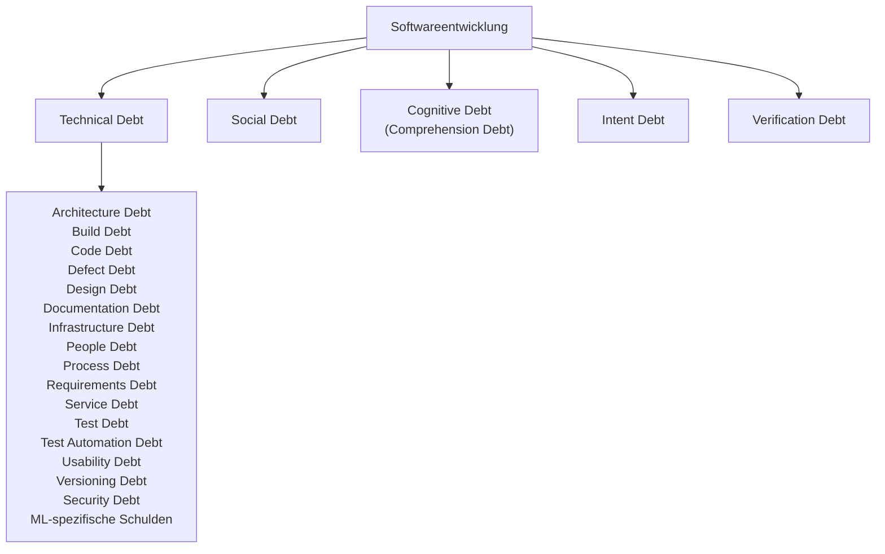

---
{"title":"Unbenannt","aliases":null,"tags":null,"gen_ai_anteil":["Claude 80%"],"created":"2026-11-07","updated":null,"status":"🌿 – Pflanze braucht Pflege","dg-publish":true,"permalink":"/unbenannt/","dgPassFrontmatter":true,"dg-note-properties":{"title":"Unbenannt","aliases":null,"tags":null,"gen_ai_anteil":["Claude 80%"],"created":"2026-11-07","updated":null,"status":"🌿 – Pflanze braucht Pflege"}}
---

# Schulden in der Softwareentwicklung

Beim Schreiben des Artikels zu [[Zum Karnickelstall/1 - Final Check/Cognitive Debt\|Cognitive Debt]] bin ich über eine erstaunlich lange Liste von Schuldenarten gestolpert. Meiner Neugier folgend habe ich Claude einen Artikel darüber schreiben lassen. Ich wünsche allen, die ebenfalls neugierig sind, viel Spaß beim Lesen 🙂

## Woher die Metapher kommt

Den Begriff **Technical Debt** (technische Schulden) prägte Ward Cunningham 1992.[^cunningham] Die Idee: Wer beim Programmieren eine Abkürzung nimmt, nimmt einen Kredit auf. Kurzfristig ist man schneller, langfristig zahlt man Zinsen, und zwar in Form von Mehraufwand bei jeder späteren Änderung.

Schulden sind dabei nicht automatisch Pfusch. Martin Fowler unterscheidet zwei Fragen:[^quadrant] Wurden die Schulden **bewusst oder versehentlich** aufgenommen? Und war das **umsichtig oder leichtsinnig**? Daraus ergeben sich vier Felder:

|                | **Bewusst**                                                           | **Versehentlich**                                                  |
| -------------- | --------------------------------------------------------------------- | ------------------------------------------------------------------ |
| **Leichtsinnig** | „Für sauberes Design haben wir keine Zeit.“                           | „Architektur? Nie gehört.“                                         |
| **Umsichtig**    | „Wir müssen jetzt liefern und kümmern uns danach um die Folgen.“      | „Jetzt wissen wir, wie wir es von Anfang an hätten machen sollen.“ |

Gerade das Feld unten rechts ist interessant: Manche Schulden lassen sich gar nicht vermeiden, weil man erst beim Bauen lernt, wie man hätte bauen sollen.

## Die Unterarten der Technical Debt

Die Forschung hat die technischen Schulden über die Jahre immer feiner unterteilt. 2014 waren es 13 Typen,[^alves] ein Jahr später kam Versioning Debt hinzu,[^li] und 2018 zählte eine große Übersichtsarbeit bereits 15.[^rios] Die Spalte „erfasst in“ zeigt, wann ein Begriff in die Systematik aufgenommen wurde; benutzt wurden die meisten schon vorher.

| Gruppe                        | Schuldenart              | Worum es geht                                                                                      | erfasst in |
| ----------------------------- | ------------------------ | -------------------------------------------------------------------------------------------------- | ---------- |
| **Code und Struktur**         | **Code Debt**            | Quellcode, der unnötig kompliziert, doppelt oder schwer lesbar ist.                                | 2014       |
|                               | **Design Debt**          | Verstöße gegen bewährte Entwurfsprinzipien, die man im Code selbst erkennen kann.                  | 2014       |
|                               | **Architecture Debt**    | Ungünstige Grundentscheidungen über den Aufbau des Systems, die sich nur mit großem Aufwand korrigieren lassen. | 2014       |
|                               | **Defect Debt**          | Bekannte Fehler, deren Behebung bewusst aufgeschoben wird.                                         | 2014       |
| **Tests**                     | **Test Debt**            | Fehlende oder unzureichende Tests.                                                                 | 2014       |
|                               | **Test Automation Debt** | Tests, die noch von Hand laufen, obwohl sie automatisiert werden müssten.                          | 2014       |
| **Infrastruktur und Betrieb** | **Build Debt**           | Ein Build-Prozess, der unnötig langsam, kompliziert oder fehleranfällig ist.                       | 2014       |
|                               | **Infrastructure Debt**  | Veraltete oder ungeeignete Plattformen und Werkzeuge, die die Entwicklung ausbremsen.              | 2014       |
|                               | **Service Debt**         | Unpassend gewählte oder veraltete Dienste in Systemen, die aus vielen einzelnen Services bestehen. | 2014       |
|                               | **Versioning Debt**      | Probleme bei der Versionsverwaltung, etwa unnötige Abspaltungen des Codes.                         | 2015       |
| **Anforderungen und Nutzer**  | **Requirements Debt**    | Anforderungen, die nur teilweise oder anders als vorgesehen umgesetzt wurden.                      | 2014       |
|                               | **Documentation Debt**   | Fehlende, unvollständige oder veraltete Dokumentation.                                             | 2014       |
|                               | **Usability Debt**       | Entscheidungen zur Bedienbarkeit, die später korrigiert werden müssen.                             | 2018       |
| **Menschen und Abläufe**      | **People Debt**          | Personelle Engpässe, etwa wenn wichtiges Wissen nur bei wenigen Personen liegt.                    | 2014       |
|                               | **Process Debt**         | Arbeitsabläufe, die nicht (mehr) zum Projekt passen.                                               | 2014       |

### Neben der Systematik

Zwei weitere Schuldenarten tauchen häufig auf, stehen aber in keiner der genannten Systematiken:

- **ML-spezifische Schulden:** Systeme mit maschinellem Lernen haben eigene Schuldenquellen, zum Beispiel die Abhängigkeit von Daten, die sich unbemerkt verändern.[^sculley]
- **Security Debt:** Angehäufte Sicherheitslücken, die nicht behoben wurden. Der Begriff stammt aus der Praxis; die Forschung hat ihn erst später aufgegriffen.[^security]

## Jenseits des Codes

Alle bisherigen Schulden stecken irgendwo im System: im Code, in den Tests, in der Infrastruktur. Andere Schuldenarten sitzen woanders, nämlich bei den Menschen, die das System bauen.

- **Social Debt:** Kosten, die durch ungünstige Zusammenarbeit und Kommunikation im Team entstehen. Der Begriff ist älter, als man denkt: Er stammt schon aus dem Jahr 2013.[^tamburri]
- **Cognitive Debt:** Das gemeinsame Verständnis des Teams hält nicht mehr Schritt mit dem Code. Mehr dazu unter [[Zum Karnickelstall/1 - Final Check/Cognitive Debt\|Cognitive Debt]].
- **Intent Debt:** Ziele und Gründe eines Systems wurden nicht oder nur unzureichend festgehalten.[^osmani] Mehr dazu unter [[Zum Karnickelstall/1 - Final Check/Cognitive Debt\|Cognitive Debt]].
- **Verification Debt:** Code, der nie gründlich geprüft wurde.[^vogels]
- **Comprehension Debt:** Im Wesentlichen ein anderer Name für Cognitive Debt.[^osmani]

## Was KI daran verschiebt

KI schreibt inzwischen erstaunlich sauberen Code und kann damit klassische Code-Schulden sogar senken. Gleichzeitig erzeugt sie Code schneller, als Menschen ihn prüfen und verstehen können. Die Schulden verschwinden also nicht, sie wandern: weg vom Code, hin zu Verification, Cognitive und Intent Debt. Warum das besonders tückisch ist, steht im Artikel zu [[Zum Karnickelstall/1 - Final Check/Cognitive Debt\|Cognitive Debt]].

## Das große Wuchern

Fassen wir zusammen: 2013 Social Debt, 2014 dreizehn Typen auf einen Schlag, 2015 Versioning und ML-Schulden, 2018 Usability, später Security, und seit 2025 eine ganze Welle neuer Begriffe rund um KI. Martin Fowler belustigt diese Vermehrung ein wenig.[^fowler] Man kann darüber schmunzeln, aber jede neue Schuldenart ist auch ein Hinweis: Da hat jemand eine Stelle gefunden, an der man heute Zeit spart und morgen dafür bezahlt.

[^cunningham]: Ward Cunningham (1992): „The WyCash Portfolio Management System“, Erfahrungsbericht auf der Konferenz OOPSLA '92.

[^quadrant]: Martin Fowler (2009): „Technical Debt Quadrant“, Eintrag in seinem Blog (Bliki). Die Beispielsätze in der Tabelle sind sinngemäß übertragen.

[^alves]: Alves et al. (2014): „Towards an Ontology of Terms on Technical Debt“, 6th IEEE International Workshop on Managing Technical Debt, [doi.org/10.1109/MTD.2014.9](https://doi.org/10.1109/MTD.2014.9). Einen praxisnahen Überblick gibt [Sourcegraph: The 11 Types of Technical Debt](https://sourcegraph.com/blog/types-of-technical-debt).

[^li]: Li, Z., Avgeriou, P. & Liang, P. (2015): „A systematic mapping study on technical debt and its management“, Journal of Systems and Software 101.

[^rios]: Rios, N., Mendonça, M. G. & Spínola, R. O. (2018): „A tertiary study on technical debt: Types, management strategies, research trends, and base information for practitioners“, Information and Software Technology 102, S. 117–145. Kleine Randnotiz: Nicolli Rios und die Erstautorin von Alves et al. (2014) sind dieselbe Person, Nicolli Souza Rios Alves.

[^sculley]: Der Klassiker dazu stammt von Forschern bei Google: Sculley et al. (2015): „Hidden Technical Debt in Machine Learning Systems“, Advances in Neural Information Processing Systems (NIPS 2015).

[^security]: Eine erste Literaturstudie dazu, von Forschenden des spanischen Instituts Tecnalia (2021): „Security Debt: Characteristics, Product Life-Cycle Integration and Items“, International Conference on Technical Debt (TechDebt 2021).

[^tamburri]: Tamburri, D. A., Kruchten, P., Lago, P. & van Vliet, H. (2013): „What is social debt in software engineering?“, 6th International Workshop on Cooperative and Human Aspects of Software Engineering (CHASE 2013).

[^osmani]: Addy Osmani (2026): „The Intent Debt“, [addyosmani.com/blog/intent-debt](https://addyosmani.com/blog/intent-debt/). Osmani schreibt dort, er habe das Phänomen, das Storey Cognitive Debt nennt, bislang „Comprehension Debt“ genannt.

[^vogels]: Bekannt gemacht hat den Begriff Werner Vogels, CTO von Amazon, in seiner Keynote auf der AWS re:Invent 2025. Wer den Begriff zuerst verwendet hat, ist unklar.

[^fowler]: Martin Fowler (2026): „Fragments: April 2“, [martinfowler.com/fragments/2026-04-02.html](https://www.martinfowler.com/fragments/2026-04-02.html).

