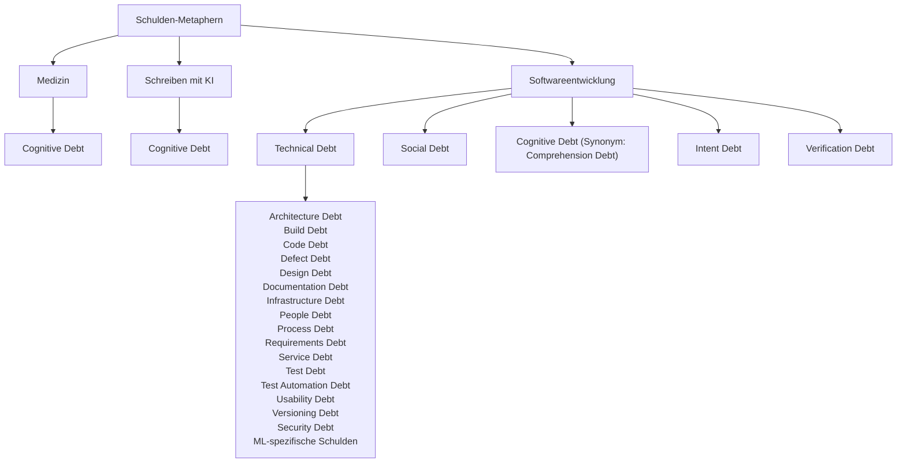

---
{"title":"Cognitive Debt","aliases":["Cognitive Debt (kognitive Schulden)","kognitive Schulden"],"tags":null,"gen_ai_anteil":["Claude 40%"],"created":"2026-10-15","updated":"2026-11-01","status":"🌳 – eine gut gepflegte Pflanze","dg-publish":true,"permalink":"/zum-karnickelstall/1-final-check/cognitive-debt/","dgPassFrontmatter":true,"dg-note-properties":{"title":"Cognitive Debt","aliases":["Cognitive Debt (kognitive Schulden)","kognitive Schulden"],"tags":null,"gen_ai_anteil":["Claude 40%"],"created":"2026-10-15","updated":"2026-11-01","status":"🌳 – eine gut gepflegte Pflanze"}}
---

# Cognitive Debt

**Cognitive Debt** („kognitive Schulden“) beschreibt die versteckten Kosten, die entstehen, wenn man sich das Denken abnehmen lässt: Kurzfristig spart man Mühe, langfristig zahlt man drauf, mit Zinsen. 

Die Metapher lehnt sich an die **Technical Debt** (technische Schulden) aus der Softwareentwicklung an, ein Begriff, den Ward Cunningham 1992 prägte: Wer heute schnell und unsauber programmiert, muss morgen teuer aufräumen.

## Ein Begriff, drei Bedeutungen

Der Begriff wird heute meist mit KI verbunden, ist aber älter. Je nach Fachgebiet meint er Unterschiedliches.

### Medizin (2015)

Natalie Marchant und Robert Howard führten den Begriff in der Alzheimer-Forschung ein.[^marchant] Gemeint sind Denk- und Verhaltensmuster, die das Risiko für Alzheimer erhöhen, allen voran wiederholtes negatives Grübeln, wie es bei Depression, Angststörungen oder chronischem Stress vorkommt.

Cognitive Debt ist hier das Gegenstück zur **kognitiven Reserve**, also dem Puffer, den Bildung, geistige Aktivität und soziale Kontakte im Gehirn aufbauen. Ist die kognitive Reserve das Sparkonto, ist Cognitive Debt die Kreditkartenrechnung.

### Schreiben mit KI (2025)

Bekannt wurde der Begriff durch eine [[Zum Karnickelstall/1 - Final Check/MIT-Studie zum Schreiben mit ChatGPT\|MIT-Studie zum Schreiben mit ChatGPT]].[^mit] Dort meint er die langfristigen Kosten, wenn ein Mensch Denkarbeit dauerhaft an KI abgibt: weniger kritisches Denken, schwächere Erinnerung, weniger eigene Ideen. Untersucht wurde nur eine einzige Aufgabe, nämlich das Schreiben von Essays. Die Medien machten daraus vielfach pauschal „ChatGPT macht dumm“.

Vielerorts liest man, das MIT habe den Begriff geprägt; wie wir jedoch gesehen haben, war er in der Alzheimer-Forschung schon zehn Jahre früher im Umlauf. 

### Softwareteams (2025/26)

Die Informatik-Professorin Margaret-Anne Storey übertrug den Begriff aufs Programmieren.[^storey] Hier geht es um das **gemeinsame Verständnis eines Teams**: Niemand weiß mehr so recht, wie und warum die eigene Software funktioniert. In diesem Sinne ist Cognitive Debt eine Eigenschaft des Projekts, nicht einer Person.

Storey teilt dabei die Auffassung, die der dänische Informatiker Peter Naur 1985 formulierte: Ein Programm ist mehr als sein Code. Es ist eine **Theorie** in den Köpfen der Entwickler darüber, was das System tun soll und warum es so gebaut ist. Geht diese Theorie verloren, bleibt nur Code übrig, den niemand mehr sicher verändern kann. 

Besonders schnell häufen sich diese Schulden beim [[Garten erkunden/Grundlagen/Vibecoding\|Vibecoding]] an, wenn KI den Code schreibt und niemand mehr genau hinschaut.

### Drei Arten von Schulden

Für die Softwareentwicklung unterscheidet Storey drei Schichten:[^storey]

| Schuldenart        | Wo sie sitzt                | Entsteht, wenn …                                                                                    | Was sie begrenzt                                  |
| ------------------ | --------------------------- | --------------------------------------------------------------------------------------------------- | ------------------------------------------------- |
| **Technical Debt** | im Code                     | Entscheidungen bei Code oder Architektur, bewusst oder unbemerkt, auf Kosten der Codequalität gehen | wie leicht sich das System weiterentwickeln lässt |
| **Cognitive Debt** | in den Köpfen des Teams     | das gemeinsame Verständnis mit dem Code nicht mehr Schritt hält                                     | wie gut das Team über Änderungen nachdenken kann  |
| **Intent Debt**    | in schriftlichen Unterlagen | Ziele und Rahmenbedingungen schlecht dokumentiert oder nicht aktualisiert werden                    | ob das System noch tut, wofür es gedacht war      |

#### Intent Debt

Intent Debt („Absichtsschulden“) entsteht, wenn Ziele, Gründe und Rahmenbedingungen eines Systems unklar formuliert, nicht aktualisiert oder gar nicht erst festgehalten wurden. In der Folge steckt dieses Wissen nur noch in den Köpfen, häufig in denen weniger Schlüsselpersonen. Solange diese an Bord sind, fällt das kaum auf. Gehen sie, geht das Wissen mit. Unsauberen Code kann man nachträglich aufräumen; Absichten lassen sich jedoch später kaum rekonstruieren. Sie sollten im Moment der Entscheidung festgehalten werden, denn fehlt diese Dokumentation, können sich neue Teammitglieder kein zutreffendes Bild machen, und das System driftet allmählich weg von dem, wofür es ursprünglich gedacht war. Mit KI wird das noch dringlicher: Auch KI-Agenten müssen wissen, wofür ein System da ist, sonst optimieren sie womöglich auf das falsche Ziel. 

## Schulden ohne Mahnung

Kognitive Schulden melden sich nicht laut. Es gibt keine Fehlermeldung, keinen abgestürzten Build. Storey beschreibt ein Studententeam, das in Woche sieben oder acht an eine Wand lief: Selbst kleine Änderungen machten plötzlich an unerwarteter Stelle etwas kaputt. Zunächst schob das Team es auf unsauberen Code. Das eigentliche Problem war ein anderes: Niemand konnte mehr erklären, warum bestimmte Entscheidungen getroffen worden waren.

### Typische Warnsignale

- **Im Team:** Das eigene System wird zur Blackbox. Fehleranalysen enden im Rätselraten.
- **Beim Einzelnen:** Man kann eigene Texte oder Lösungen nicht wiedergeben oder erklären. Ohne KI fällt der Einstieg schwer.

> [!warning] Achtung, sauberer Code!
> Mit jeder neuen Modellgeneration schreibt KI besseren Code – fast schon beängstigend gut inzwischen. Dadurch kann sie technische Schulden sogar senken. Da sie aber auf Knopfdruck große Mengen solchen Codes erzeugt, können sich kognitive Schulden und Absichtsschulden ebenso schnell anhäufen. Früher war chaotischer Code oft das erste Warnsignal, dass ein Projekt aus dem Ruder läuft. Dieses Signal fällt weg. Sauberer Code wiegt uns in Sicherheit, während die eigentlichen Schulden im Verborgenen wachsen.

## Nicht jedes Auslagern ist ein Problem

Gedächtnis und Denken an Hilfsmittel abzugeben ist nichts Neues. Die Kognitionspsychologie nennt das **Cognitive Offloading** (kognitive Entlastung).[^offloading] Wir tun es ständig: mit Kalendern, Einkaufslisten und Taschenrechnern.

Der Unterschied liegt darin, *was* man auslagert:

- **Unproblematisch:** Dinge, die man nicht selbst können muss. Einen Termin muss ich mir nicht merken, wenn er im Kalender steht.
- **Problematisch:** Fähigkeiten, die man eigentlich aufbauen oder behalten will. Wer jedes Urteil, jede Analyse und jeden Gedankengang der KI überlässt, verlernt genau das.

## Gegenmittel

> [!quote] Denken kann man auslagern, Verständnis nicht.
> _– Andrej Karpathy (2026)_

Daraus folgt Karpathys wichtigste Regel,[^karpathy] für Einzelne wie für Teams: **Die KI nichts bauen lassen, was man selbst nicht versteht.**

**Für Einzelne:**
- Erst selbst denken, dann KI. Eigentlich naheliegend; es überrascht nicht, dass auch die MIT-Studie in diese Richtung deutet.
- Für besseres Verständnis: sich von der KI Fragen stellen lassen, statt Antworten einzufordern. Mehr dazu unter [[Garten erkunden/Digitale Gärten, PKM & Lernen/Aktives Lernen\|Aktives Lernen]].
- Ab und zu ohne KI arbeiten. Nicht aus Prinzip, sondern als Experiment: Kann ich das noch?[^selbstversuch]

**Für Teams:**
- Bewusst langsamer werden, wenn das Verständnis nicht mehr hinterherkommt.
- Entscheidungen und deren Gründe aufschreiben. Das bekämpft gleichzeitig Intent Debt.
- KI-generierten Code gemeinsam besprechen, statt ihn ungelesen zu übernehmen.

Alles Dinge, die eigentlich der gesunde Menschenverstand gebieten würde; allerdings ist fraglich, ob er Gehör finden wird in unserer Zeit, die so sehr von Geschwindigkeit, Effizienz und „Produktivität“ besessen ist.

## Kritik am Begriff

- **Schwer messbar:** „Schulden“ ist eine Metapher. Wie viel Cognitive Debt ein Mensch oder Team angehäuft hat, lässt sich nicht beziffern.
- **Braucht es überhaupt einen neuen Begriff?** Manche halten den Begriff für überflüssig, weil es mit Cognitive Offloading oder **Deskilling** (Verlust von Fähigkeiten durch Automatisierung) längst etablierte Begriffe gibt.
- Speziell an der [[Zum Karnickelstall/1 - Final Check/MIT-Studie zum Schreiben mit ChatGPT\|MIT-Studie zum Schreiben mit ChatGPT]] gibt es einiges auszusetzen: nur 54 Teilnehmende, kein Peer-Review, methodische Schwächen.

## So viele Schulden – und eine neue Art?

Technical Debt, Cognitive Debt, Intent Debt – und wir haben noch lange nicht das Ende der Fahnenstange erreicht:

- **In der Softwareforschung** zählt man allein bei den technischen Schulden längst über ein Dutzend Unterarten, von Architecture Debt bis Test Debt.[^debt-typen]
- **Im KI-Umfeld** tauchen laufend neue auf, oft für fast dasselbe: Was Storey Cognitive Debt nennt, heißt bei anderen „Comprehension Debt“.[^osmani]

Das Wuchern der Schulden-Metaphern ruft durchaus auch Belustigung hervor.[^fowler] 

Um dieser guten Tradition zu folgen, habe ich beschlossen, noch eine weitere Form der Schulden hinzuzufügen. 

> Ich nenne sie: [[Zum Karnickelstall/1 - Final Check/Collective Cognitive Debt\|Collective Cognitive Debt]].

Das stetige Anschwellen der Begriffsflut lässt auch mich schmunzeln, aber das Phänomen hinter diesem neuen Begriff erfüllt mich mit großer Sorge.

Die Idee kam mir, als ich mich mit Karpathys Gedanken zur [[Zum Karnickelstall/1 - Final Check/KI – alles nur Hype? Wenn nur wenige verstehen, was gerade entsteht\|AI Understanding Gap]] beschäftigte: _Moment, das ist doch auch eine Form kognitiver Schulden, und zwar eine, welche die gesamte Menschheit betrifft._ Das Prinzip gilt auch hier: „Jetzt Tempo machen, später die Rechnung bezahlen.“ Nur dürfte diese Rechnung weitaus höher ausfallen als bei jedem Softwareprojekt.

Falls Du die Unterarten doch lieber als einzelne Kästen haben willst, sag Bescheid. Dann wird es aber sehr breit.
## 📖 Weiterlesen

- Kognitive Schulden durch Verwendung von KI sind keine zwangsläufige Folge: Während sie beim [[Garten erkunden/Grundlagen/Vibecoding\|Vibecoding]] besonders schnell entstehen, behalten beim [[Garten erkunden/Grundlagen/Agentic Engineering\|Agentic Engineering]] Entwickler Architektur und Verständnis bewusst selbst in der Hand.
- Mich hat es dann doch interessiert, was es mit all diesen Schuldenarten im Detail auf sich hat, daher habe ich Claude einen Artikel schreiben lassen: [[Zum Karnickelstall/1 - Final Check/Schulden in der Softwareentwicklung\|Schulden in der Softwareentwicklung]]

## 📺 Aus der YouTube-Akademie

- Ein sehr empfehlenswertes Video zu kognitiven Schulden in der Softwareentwicklung: [AI Cognitive Debt: The Crisis Nobody Sees Coming](https://www.youtube.com/watch?v=Tk0hIOAwf6M)
- Noch eine interessante Perspektive: Hier geht es um Architectural Tech Debt, die entsteht, wenn in einem Unternehmen keiner mehr Code lesen kann („zero-knowledge stack“); nebenbei erfahren wir, warum KI-Agenten die Programmiersprache Rust lieben: [The AI Skeptics were right... just not how you think](https://www.youtube.com/watch?v=Ah6YTqSbsnU)

[^marchant]: Marchant, N. L. & Howard, R. J. (2015): „Cognitive Debt and Alzheimer's Disease“, Journal of Alzheimer's Disease 44(3), S. 755–770. [doi.org/10.3233/JAD-141515](https://doi.org/10.3233/JAD-141515)

[^mit]: Kosmyna et al. (2025): „Your Brain on ChatGPT: Accumulation of Cognitive Debt when Using an AI Assistant for Essay Writing Task“, arXiv:2506.08872.

[^storey]: Margaret-Anne Storey (2026): „How Generative and Agentic AI Shift Concern from Technical Debt to Cognitive Debt“, [margaretstorey.com/blog/2026/02/09/cognitive-debt](https://margaretstorey.com/blog/2026/02/09/cognitive-debt/). Erstmals verwendet hat sie den Begriff laut eigener Aussage im Oktober 2025 in einem Startup-Kurs.

[^offloading]: Geprägt u. a. von Evan Risko und Sam Gilbert (2016): „Cognitive Offloading“, Trends in Cognitive Sciences.

[^karpathy]: Andrej Karpathy im Gespräch mit Stephanie Zhang auf der Konferenz AI Ascent 2026 von Sequoia Capital (April 2026). Im Original: „You can outsource your thinking, but you can't outsource your understanding.“ [Video ab 27:56](https://www.youtube.com/watch?v=96jN2OCOfLs&t=1676s)

[^debt-typen]: Eine viel zitierte Systematik stammt von Alves et al. (2014): „Towards an Ontology of Terms on Technical Debt“, 6th IEEE International Workshop on Managing Technical Debt, [doi.org/10.1109/MTD.2014.9](https://doi.org/10.1109/MTD.2014.9). Sie unterscheidet 13 Typen, darunter Architecture, Test und Documentation Debt. Einen praxisnahen Überblick gibt [Sourcegraph: The 11 Types of Technical Debt](https://sourcegraph.com/blog/types-of-technical-debt).

[^osmani]: Addy Osmani (2026): „The Intent Debt“, [addyosmani.com/blog/intent-debt](https://addyosmani.com/blog/intent-debt/). Osmani schreibt dort, er habe dasselbe Phänomen bislang „Comprehension Debt“ genannt.

[^fowler]: Martin Fowler (2026): „Fragments: April 2“, [martinfowler.com/fragments/2026-04-02.html](https://www.martinfowler.com/fragments/2026-04-02.html). Zu Storeys Modell schreibt er, die Vermehrung der Schulden-Metaphern belustige ihn ein wenig; das Modell selbst hält er dennoch für sinnvoll.

[^selbstversuch]: Sagt jemand, der das selbst kaum macht. Ehrlich gesagt habe ich das Gefühl, dass [[Zum Karnickelstall/Must-Have/Schreiben mit KI\|Schreiben mit KI]] mich nicht dümmer, sondern intelligenter macht, mehr noch: Würde KI heute verschwinden, könnte ich besser schreiben als vorher. Nur ist das subjektive Gefühl ein ziemlich unzuverlässiger Indikator. In einer Studie von METR (2025) schätzten erfahrene Entwickler, dass sie mit KI rund 20 % schneller gewesen seien. Tatsächlich waren sie laut Messung aber 19 % langsamer (Becker, Rush et al.: „Measuring the Impact of Early-2025 AI on Experienced Open-Source Developer Productivity“, [arxiv.org/abs/2507.09089](https://arxiv.org/abs/2507.09089)). Obwohl ich also weiß, dass so ein Gefühl leicht trügen kann, habe ich wenig Lust, wieder gelegentlich ohne KI zu arbeiten. Warum auch? Warum wieder Kopfrechnen, wenn es Taschenrechner gibt? Der Punkt ist: Es macht mir Freude, KI als Hilfsmittel zu nutzen, und nebenbei finde ich die Ergebnisse besser. Anders in der Softwareentwicklung: Hier höre ich oft, dass sich Programmierer zu bloßen Aufpassern für die codegenerierende KI degradiert fühlen und die Freude am Beruf verloren haben. Immerhin hatten sie diese Freude einmal und konnten in ihrem Beruf arbeiten. Mir war meine Liebe zum Code früh bewusst, aber ich bin ihrem Ruf zu spät gefolgt. Als meine Ausbildung abgeschlossen war, war der Bedarf an Junior-Entwicklern quasi bei null angekommen und der Beruf in seiner bisherigen Form nicht mehr vorhanden. Noch ein letzter Gedanke für diese ausufernde Fußnote: Bei der METR-Studie waren es gerade einmal 16 Teilnehmende, bei der MIT-Studie 54. Von einem Konsens der Wissenschaft kann also kaum die Rede sein. Trotzdem werden die Ergebnisse beider Studien ständig als gesicherte Fakten weitergereicht: „ChatGPT macht dumm“, „KI macht Programmierer langsamer“. Je öfter man das liest, desto fundierter wirkt es, obwohl die Grundlage dieselbe bleibt. Dafür gibt es sogar einen Namen: **Woozle-Effekt**.