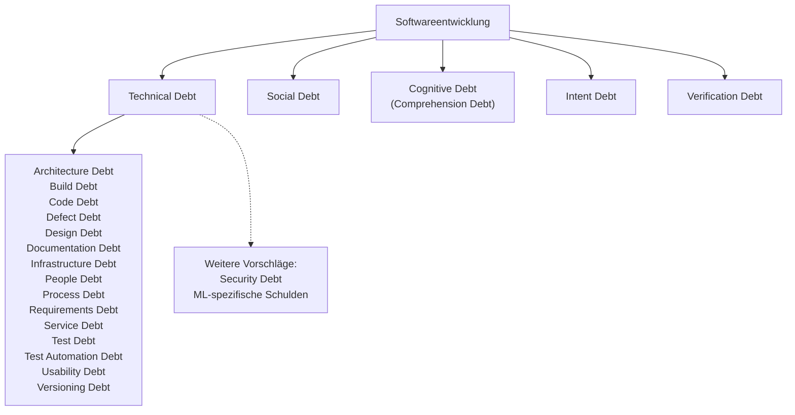

---
{"title":"Schulden in der Softwareentwicklung","aliases":null,"tags":null,"gen_ai_anteil":["Claude 60%"],"created":"2026-11-07","updated":"2026-11-12","status":"🌳 – eine gut gepflegte Pflanze","dg-publish":true,"permalink":"/zum-karnickelstall/1-final-check/schulden-in-der-softwareentwicklung/","dgPassFrontmatter":true,"dg-note-properties":{"title":"Schulden in der Softwareentwicklung","aliases":null,"tags":null,"gen_ai_anteil":["Claude 60%"],"created":"2026-11-07","updated":"2026-11-12","status":"🌳 – eine gut gepflegte Pflanze"}}
---

# Schulden in der Softwareentwicklung

Beim Schreiben des Artikels zu [[Garten erkunden/Verschiedenes/Cognitive Debt\|Cognitive Debt]] bin ich über eine erstaunlich lange Liste von Schuldenarten gestolpert. Meiner Neugier folgend ist dieser Artikel entstanden. Ich wünsche allen, die ebenfalls neugierig sind, viel Spaß beim Lesen 🙂

## Woher die Metapher kommt

Den Begriff **Technical Debt** (technische Schulden) prägte Ward Cunningham 1992.[^cunningham] Die Idee: Wer beim Programmieren eine Abkürzung nimmt, nimmt einen Kredit auf. Kurzfristig ist man schneller, langfristig zahlt man Zinsen, und zwar in Form von Mehraufwand bei jeder späteren Änderung.

Schulden sind dabei nicht automatisch Pfusch. Martin Fowler unterscheidet zwei Fragen:[^quadrant] Wurden die Schulden **bewusst oder versehentlich** aufgenommen? Und war das **umsichtig oder leichtsinnig**? Daraus ergeben sich vier Felder:

|                | **Bewusst**                                                           | **Versehentlich**                                                  |
| -------------- | --------------------------------------------------------------------- | ------------------------------------------------------------------ |
| **Leichtsinnig** | „Für sauberes Design haben wir keine Zeit.“                           | „Architektur? Nie gehört.“                                         |
| **Umsichtig**    | „Wir müssen jetzt liefern und kümmern uns danach um die Folgen.“      | „Jetzt wissen wir, wie wir es von Anfang an hätten machen sollen.“ |

### Umsichtige, versehentliche Schulden

Manche Schulden lassen sich kaum vermeiden, weil man erst beim Bauen lernt, wie man hätte bauen sollen:

- Man versteht das Problem erst durch die Arbeit daran, 
- man weiß am Anfang nicht, was man nicht weiß, 
- die Anforderungen ändern sich im Laufe des Projekts. 

Ein typisches Beispiel: Ein Team entwirft ein System für Bestellungen und geht davon aus, dass jede Bestellung genau eine Lieferadresse hat. Erst im Betrieb zeigt sich, dass Kunden Sammelbestellungen an mehrere Standorte aufgeben. Die falsche Annahme steckt zu diesem Zeitpunkt schon überall im Code. Mit dem Wissen von heute hätte man es anders entworfen, aber damals gab es dieses Wissen nicht.

## Die Unterarten der Technical Debt

Die Forschung hat die technischen Schulden über die Jahre immer feiner unterteilt. 2014 waren es 13 Typen,[^alves] 2016 wuchs die Systematik mit Versioning und Usability Debt auf 15.[^alves2016] Auch eine große Übersichtsarbeit von 2018 zählt 15.[^rios]

| Gruppe                        | Schuldenart              | Worum es geht                                                                                                   |
| ----------------------------- | ------------------------ | --------------------------------------------------------------------------------------------------------------- |
| **Code und Struktur**         | **Code Debt**            | Quellcode, der unnötig kompliziert, an mehreren Stellen wiederholt oder schwer lesbar ist.                      |
|                               | **Design Debt**          | Verstöße gegen bewährte Designprinzipien, die man im Code selbst erkennen kann.                                 |
|                               | **Architecture Debt**    | Ungünstige Grundentscheidungen über den Aufbau des Systems, die sich nur mit großem Aufwand korrigieren lassen. |
|                               | **Defect Debt**          | Bekannte Fehler, deren Behebung bewusst aufgeschoben wird.                                                      |
| **Tests**                     | **Test Debt**            | Fehlende oder unzureichende Tests.                                                                              |
|                               | **Test Automation Debt** | Tests, die noch von Hand laufen, obwohl sie automatisiert werden müssten.                                       |
| **Infrastruktur und Betrieb** | **Build Debt**           | Ein Build-Prozess, der unnötig langsam, kompliziert oder fehleranfällig ist.                                    |
|                               | **Infrastructure Debt**  | Veraltete oder ungeeignete Plattformen und Werkzeuge, die die Entwicklung ausbremsen.                           |
|                               | **Service Debt**         | Unpassend gewählte oder veraltete Dienste in Systemen, die aus vielen einzelnen Services bestehen.              |
|                               | **Versioning Debt**      | Probleme bei der Versionsverwaltung, etwa Branches (Entwicklungszweige), die zu lange nebeneinander herlaufen.  |
| **Anforderungen und Nutzer**  | **Requirements Debt**    | Anforderungen, die nur teilweise oder anders als vorgesehen umgesetzt wurden.                                   |
|                               | **Documentation Debt**   | Fehlende, unvollständige oder veraltete Dokumentation.                                                          |
|                               | **Usability Debt**       | Entscheidungen zur Benutzerfreundlichkeit, die später korrigiert werden müssen.                                 |
| **Menschen und Abläufe**      | **People Debt**          | Personelle Engpässe, etwa wenn wichtiges Wissen nur bei wenigen Personen liegt.                                 |
|                               | **Process Debt**         | Arbeitsabläufe, die nicht (mehr) zum Projekt passen.                                                            |

## Weitere Schuldenarten außerhalb der Systematik

Einige Begriffe stehen in keiner der genannten Systematiken:

* **ML-spezifische Schulden:** Systeme mit [[Zum Karnickelstall/5 - soon/Machine Learning (ML)\|maschinellem Lernen ]]haben eigene Schuldenquellen, zum Beispiel die Abhängigkeit von Daten, die sich unbemerkt verändern. Die grundlegende Arbeit dazu stammt von Google-Forschern aus dem Jahr 2015, lange vor dem aktuellen KI-Boom.[^sculley]
* **Security Debt:** Angehäufte Sicherheitslücken, die nicht behoben wurden. Die Forschung beschäftigt sich damit erst seit Kurzem systematisch.[^security]
* **Social Debt:** Kosten, die durch ungünstige Zusammenarbeit und Kommunikation im Team entstehen.[^tamburri]

### Die neue Welle seit 2025

Seit 2025 ist eine ganze Reihe neuer Begriffe dazugekommen. Sie drehen sich um die Frage, was passiert, wenn KI Code schneller erzeugt, als Menschen ihn verstehen, prüfen und begründen können:

* **Cognitive Debt:** Das gemeinsame Verständnis des Teams hält nicht mehr Schritt mit dem Code.[^storey] Mehr dazu unter [[Garten erkunden/Verschiedenes/Cognitive Debt\|Cognitive Debt]].
* **Intent Debt:** Ziele und Gründe eines Systems wurden nicht oder nur unzureichend festgehalten. Mehr dazu unter [[Garten erkunden/Verschiedenes/Cognitive Debt#Intent Debt\|Intent Debt]].
* **Verification Debt:** Code, der nie gründlich geprüft wurde.[^vogels]
* **Comprehension Debt:** Im Wesentlichen ein anderer Name für Cognitive Debt.[^osmani]

KI schreibt inzwischen erstaunlich sauberen Code und kann damit klassische Code-Schulden sogar senken. Gleichzeitig erzeugt sie Code schneller, als Menschen ihn prüfen und verstehen können. Die Schulden verschwinden also nicht, sie wandern: weg vom Code, hin zu Verification, Cognitive und Intent Debt.

Schon vor der KI gab es Schulden, die nicht im System liegen (im Code, in den Tests, in der Infrastruktur), sondern in den Menschen, zum Beispiel People Debt und Social Debt. Diese Tendenz verstärkt sich jetzt noch. Warum das besonders tückisch ist, steht im Artikel zu [[Garten erkunden/Verschiedenes/Cognitive Debt\|Cognitive Debt]].

## Das große Wuchern

Es fing 1992 mit einer einzigen Metapher an: Technical Debt. Seither ist die Schuldenfamilie ordentlich gewachsen, und seit 2025 kommt mit KI eine ganze Welle neuer Begriffe dazu.

Mir geht es da wie Martin Fowler (der mit dem Quadranten von oben)[^fowler]: mich belustigt diese Vermehrung ein wenig. Aber mich fasziniert auch, wie präzise Menschen dieses Phänomen kategorisiert haben. Wenn man ein Phänomen kennt und versteht, kann man bewusst und umsichtig damit umgehen. Überlegtes, sorgfältiges Vorgehen zahlt sich aus, in der Software und anderswo; eine Weisheit, die in Zeiten von KI mit ihrem Geschwindigkeitsrausch allerdings leicht übersehen wird. In dieser Hinsicht sehe ich eine Rechnung von gigantischem Ausmaß auf die Menschheit zukommen: mehr dazu in meinem Artikel [[Zum Karnickelstall/1 - Final Check/Collective Cognitive Debt\|Collective Cognitive Debt]]. 

[^cunningham]: Ward Cunningham (1992): „The WyCash Portfolio Management System“, Erfahrungsbericht auf der Konferenz OOPSLA '92.

[^quadrant]: Martin Fowler (2009): „Technical Debt Quadrant“, Eintrag in seinem Blog (Bliki). Die Beispielsätze in der Tabelle sind sinngemäß übertragen.

[^alves]: Alves et al. (2014): „Towards an Ontology of Terms on Technical Debt“, 6th IEEE International Workshop on Managing Technical Debt, [doi.org/10.1109/MTD.2014.9](https://doi.org/10.1109/MTD.2014.9). Einen praxisnahen Überblick (welcher etwas anders zählt) gibt [Sourcegraph: The 11 Types of Technical Debt](https://sourcegraph.com/blog/types-of-technical-debt).

[^alves2016]: Alves, N. S. R., Mendes, T. S., de Mendonça, M. G., Spínola, R. O., Shull, F. & Seaman, C. (2016): „Identification and management of technical debt: A systematic mapping study“, Information and Software Technology 70, S. 100–121. [doi.org/10.1016/j.infsof.2015.10.008](https://doi.org/10.1016/j.infsof.2015.10.008)

[^rios]: Rios, N., Mendonça, M. G. & Spínola, R. O. (2018): „A tertiary study on technical debt: Types, management strategies, research trends, and base information for practitioners“, Information and Software Technology 102, S. 117–145. Kleine Randnotiz: Nicolli Rios ist sehr wahrscheinlich dieselbe Person wie die Erstautorin von Alves et al. (2014), Nicolli Souza Rios Alves.

[^sculley]: Sculley et al. (2015): „Hidden Technical Debt in Machine Learning Systems“, Advances in Neural Information Processing Systems 28 (NIPS 2015), S. 2503–2511.

[^tamburri]: Tamburri, D. A., Kruchten, P., Lago, P. & van Vliet, H. (2013): „What is social debt in software engineering?“, 6th International Workshop on Cooperative and Human Aspects of Software Engineering (CHASE 2013), S. 93–96, [doi.org/10.1109/CHASE.2013.6614739](https://doi.org/10.1109/CHASE.2013.6614739)

[^security]: Martinez, J. et al. (2021): „Security Debt: Characteristics, Product Life-Cycle Integration and Items“, 4th IEEE/ACM International Conference on Technical Debt (TechDebt 2021), [doi.org/10.1109/TechDebt52882.2021.00009](https://doi.org/10.1109/TechDebt52882.2021.00009). Eine erste Literaturübersicht dazu, von Forschenden des Instituts Tecnalia im Baskenland.

[^osmani]: Addy Osmani (2026): „The Intent Debt“, [addyosmani.com/blog/intent-debt](https://addyosmani.com/blog/intent-debt/). Osmani schreibt dort, er habe das Phänomen, das Storey Cognitive Debt nennt, bislang „Comprehension Debt“ genannt.

[^vogels]: Bekannt gemacht hat den Begriff Werner Vogels, CTO von Amazon, in seiner Keynote auf der AWS re:Invent 2025. Wer den Begriff zuerst verwendet hat, ist unklar.

[^fowler]: Martin Fowler (2026): „Fragments: April 2“, [martinfowler.com/fragments/2026-04-02.html](https://www.martinfowler.com/fragments/2026-04-02.html).

[^storey]: Margaret-Anne Storey (2026): „How Generative and Agentic AI Shift Concern from Technical Debt to Cognitive Debt“, [margaretstorey.com/blog/2026/02/09/cognitive-debt](https://margaretstorey.com/blog/2026/02/09/cognitive-debt/).